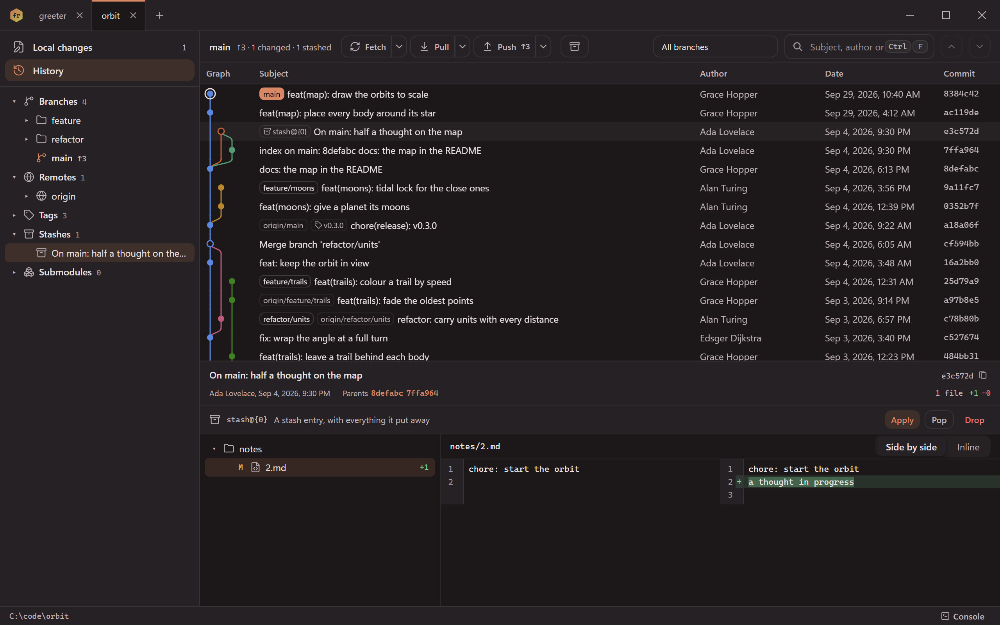
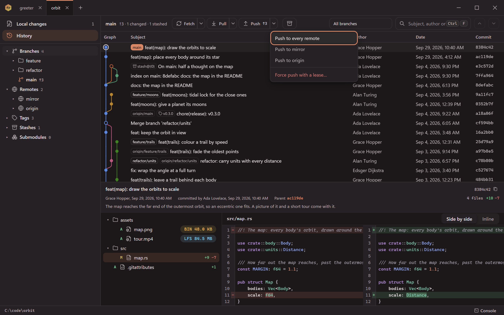
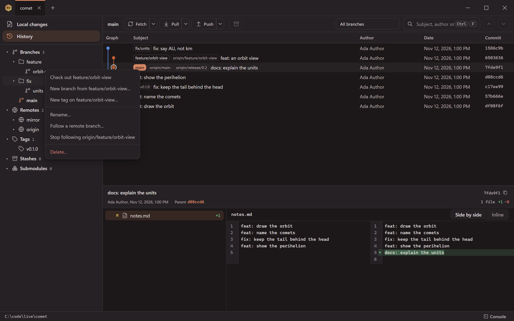
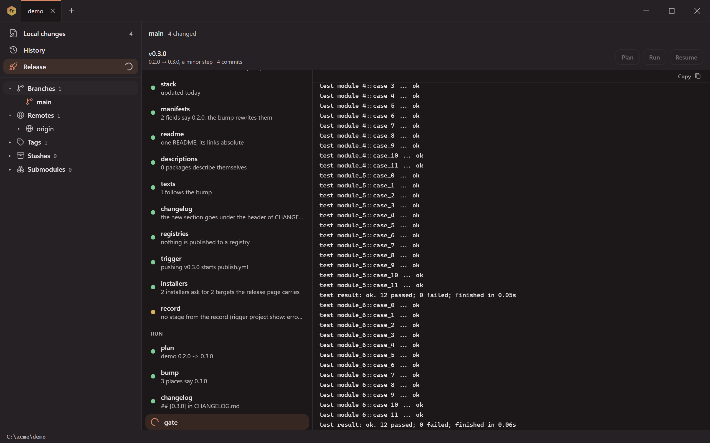

The desktop window is the third door onto the same engine as the CLI: what it
shows of a repository is what `furca log`, `furca status`, `furca refs` and `furca line` print,
read the same way, in-process. It is laid out as Fork lays a git client out -
tabs of repositories along the top, a column of refs on the left, the graph of
the history beside it - and it draws its own title bar, so the tabs sit in it
rather than in a band under it.


## Get it

There is no installer yet: the window's installers wait for code signing, since
an unsigned one is what SmartScreen and Gatekeeper turn away. CI builds them for
every platform on every push, and the window builds from a checkout:

```sh
pnpm install
pnpm tauri build          # or `pnpm tauri dev` to run it from the source
```

See [CONTRIBUTING](https://github.com/lacodda/furca/blob/main/CONTRIBUTING.md)
for what it needs.

## Opening repositories

Each open repository is a tab. A repository opens

- from **Open repository…** (<kbd>Ctrl</kbd>+<kbd>O</kbd>), which asks for a
  folder;
- from **Recent**, the repositories opened lately, in the `+` menu after the
  tabs and on the empty window;
- by **dropping a folder** on the window - or a file: a path inside a working
  tree opens the repository around it, as `git -C` does;
- from a terminal: `furca-desktop PATH` opens `PATH`. With the window open
  already, the path opens as a tab in it and the window comes forward - there
  is one window, and its tabs are the one list of what is open.

Opening a repository that is open already brings its tab forward instead of
opening a second one, however the path was written. Two tabs with the same
directory name add their parent's, so the bar never shows two it cannot tell
apart.

| Keys | |
| --- | --- |
| <kbd>Ctrl</kbd>+<kbd>O</kbd> | Open a repository |
| <kbd>Ctrl</kbd>+<kbd>W</kbd>, <kbd>Delete</kbd> on a tab, a middle click | Close the tab |
| <kbd>Ctrl</kbd>+<kbd>Tab</kbd>, <kbd>Ctrl</kbd>+<kbd>Shift</kbd>+<kbd>Tab</kbd> | The next or the previous tab |
| <kbd>Ctrl</kbd>+<kbd>1</kbd> … <kbd>Ctrl</kbd>+<kbd>8</kbd>, <kbd>Ctrl</kbd>+<kbd>9</kbd> | That tab, the last tab |

Tabs are dragged along the bar to change their order; a strip too long for the
bar scrolls with the wheel. The keys are read by their place on the keyboard,
so they work on any layout.

## Sessions

A session is a set of tabs saved under a name: **Save tabs as a session…** in
the `+` menu. Opening it later replaces the open tabs with its own, in its
order, with the one that was in front in front again. Saving under a name
that is taken replaces that session, and the dialog says so first.

**The line** is a session that is never saved: every repository your
[rigger](https://lacodda.github.io/rigger/) record keeps - the list
[`furca line`](/furca/reference/line/) reads - fetched from the record each time
it opens, so a project added to the record is in it the next time. It is
offered only where rigger is installed.

A repository of a session that is no longer there is left out, and the window
says which.

## The left column

At the top are the two things the middle of the window shows of a repository:
**Local changes**, with how many files differ from `HEAD`, and **History**. Under
them are the repository's refs:

| Section | What it shows |
| --- | --- |
| **Branches** | Local branches, in folders by the `/` in their names. The branch `HEAD` is on is in bold with its mark in the accent; `↑2 ↓1` is how far it is from its upstream, and `gone` an upstream deleted on the remote and pruned. A right click checks one out, branches from it, renames it, sets what it follows or deletes it - see [Branches and tags](#branches-and-tags). |
| **Remotes** | Each remote with its remote-tracking branches, in folders the same way. Pointing at a remote shows its address, without any password written into it; a right click fetches, prunes, edits or removes it - see [Fetching, pulling and pushing](#fetching-pulling-and-pushing). |
| **Tags** | Newest version first: `v1.10.0` comes before `v1.9.0`. A right click checks one out on no branch, pushes it or deletes it. |
| **Stashes** | The stash, newest first, by the message git wrote. Choosing an entry opens it under the graph, with what can be done to it - see [Stashing](#stashing). |
| **Submodules** | Each submodule by its path, marked `not checked out` when it is not, and `moved` when what is checked out is not the commit the repository records. |

The distances are against the last fetch: the window reads this machine only
and asks no remote until you fetch. The column is one control - <kbd>Tab</kbd> reaches it once,
the arrows move inside it, <kbd>Right</kbd> and <kbd>Left</kbd> open and close a
folder. Choosing a branch, a remote branch, a tag or a stash entry takes the
graph to its commit.

## The graph

Beside the column is the history, in the order `git log --all --date-order`
lists it: a commit is never below one of its parents, and among the commits
that could come next the newest goes first. Each line of descent is a lane of
its own colour, and a branch keeps its lane from its tip down to where it forked
off, so the eye can follow it. A hollow dot is a merge; the commit `HEAD` is on
has a ring.

| Column | |
| --- | --- |
| **Graph** | The lanes. A history wider than sixteen lanes is cut at the right edge of the column. |
| **Subject** | The first line of the message, after what points at the commit: the branch `HEAD` is on in the accent, other branches, remote-tracking branches, tags and stash entries. |
| **Author** | Who wrote it; pointing at the name shows the address. |
| **Date** | When it was written, in your language's format. |
| **Commit** | The short id. |

Above the graph, the branch `HEAD` is on and how far it stands from its
upstream, with what is changed, untracked and stashed. **History of** shows
the history of one branch - local or remote-tracking - instead of everything;
the commit you had chosen stays chosen when it is in that history too.

The graph is read in pages as it scrolls, and the history is laid out in the
background while the first screen is already there: a history of a hundred
thousand commits opens as fast as one of a hundred. See
[ADR 0012](https://github.com/lacodda/furca/blob/main/docs/adr/0012-the-graph-stays-in-the-app-and-the-window-asks-for-rows.md).

### Searching

<kbd>Ctrl</kbd>+<kbd>F</kbd> searches the history: the words of a subject, an
author's name or address, or the start of a commit's id - four hex digits or
more, as git takes an abbreviated id. Case does not matter. The search goes
through the whole history, the first matches arrive at once, and the window
moves to the first one from where you are; the places found are marked in each
row.

| Keys | |
| --- | --- |
| <kbd>Enter</kbd>, <kbd>Shift</kbd>+<kbd>Enter</kbd> | The next or the previous match |
| <kbd>Escape</kbd> | End the search |

With [nooma](https://lacodda.github.io/nooma/) on the `PATH`, the search asks
its history of the repository too, which reads the whole message: a commit
whose reason is written only in the body of its message is found, and marked
**in the message**. nooma reads a repository's history the first time it is
asked and keeps it, so the first search there takes a moment longer. Without
nooma the search is furca's own.

### Moving through the history

The graph is one control: <kbd>Tab</kbd> reaches it once.

| Keys | |
| --- | --- |
| <kbd>Up</kbd>, <kbd>Down</kbd> | The commit above or below |
| <kbd>Page Up</kbd>, <kbd>Page Down</kbd> | A screen up or down |
| <kbd>Home</kbd>, <kbd>End</kbd> | The newest commit, the first one |

A commit, a fetch or a checkout made in a terminal shows up as it happens: the
window hears `HEAD` and the refs of the tab in front move. A tab is read again
when it comes forward too, and when the window gets the focus back. The graph is
laid out again only when a branch, a tag or `HEAD` moved.

## A commit's details

Under the graph is the commit you chose - the one `HEAD` is on when a
repository opens, as Fork opens one. Its header says who made it and when, its
id (a click copies it), its parents (a click takes the graph there), the whole
message, and how many files and lines it changed. The commit is compared with
its first parent: a merge shows what it brought into the line it was merged
into.

Below the header, on the left, are the files it changed, in their folders - a
folder that only holds another is one row, `src/lib`. Each says how it changed
(**A** added, **M** modified, **D** deleted, **R** renamed, **C** copied) and,
at the right edge, the lines it added and removed. A file that is not text says
what it is and how large instead:

| | |
| --- | --- |
| **BIN** | A binary committed as it is. Marked in the warning colour: every version of it stays in the history for good, which in a public repository is the most expensive mistake a commit can make. |
| **LFS** | A file in git LFS. The size is the file's, not the pointer's. |
| **SUB** | A submodule moved to another of its commits. |

On the right is the change of the file chosen, as `git diff` counts it, with
its language's colours: **Side by side** keeps the two versions level, line for
line; **Inline** shows the removed lines over the added ones. A removed line is
marked `−` and an added one `+`, so the change reads without colour too, and
the characters that changed inside a line are marked again. Unchanged
stretches fold away to a line saying how many there are - a click opens them -
so a long file opens as fast as its changes allow. The header above the change
names a rename and how alike the file stayed, a change of mode, and line
endings that changed - `CRLF → LF` - which otherwise show as every line
changed for no visible reason.

The window keeps where you put the borders between the graph, the files and
the change, and which way changes are drawn, with the tabs.

## Local changes

**Local changes** (<kbd>Ctrl</kbd>+<kbd>L</kbd>; <kbd>Ctrl</kbd>+<kbd>H</kbd> goes
back to the history) shows what differs from `HEAD`, kept up to date as files are
saved. Nothing needs refreshing: save a file in your editor and its row and its
open change follow in a moment.


| List | What it holds |
| --- | --- |
| **Conflicted** | Paths a merge left unresolved, and how the two sides disagree. |
| **Staged** | What the next commit would change. |
| **Not staged** | What the index does not have. A file both staged and changed again is in both lists, and each shows its own change. |
| **Untracked** | Files git does not track and does not ignore, each on its own. |

The lists are one control, as the left column is: <kbd>Tab</kbd> reaches it once
and the arrows move through all of them. A row says what a commit's file says -
how it changed, its lines, and **BIN**, **LFS** or **SUB** with a size for a file
with no lines - and the warning on a binary comes while it can still be left out of
the commit. What a file holds is read just after the list arrives, so a change
across thousands of files lists them at once and fills in. The window is given
the first thousand rows of each list and says how many more there are;
[`furca status`](/furca/reference/status/) prints them all.

On the right is the change of the chosen file, drawn as a commit's is, against
what is on disk: a file is compared as `git add` would take it, so with
`core.autocrlf` on, a checkout's `\r\n` is no change. It keeps your place when
the file is saved again. A file staged in a terminal moves to the other list with
the choice following it; one that has gone from every list hands over to the row
now in its place.

What git ignores never wakes the list, so a build in an ignored folder costs
nothing. See
[ADR 0014](https://github.com/lacodda/furca/blob/main/docs/adr/0014-the-status-is-kept-by-the-paths-a-watcher-names.md).

Only the tab in front is watched; the others are read when they come forward. A
working tree that cannot be watched - on Linux, one past the system's limit of
inotify watches, where each folder takes one and what git ignores takes none - is
read when the window gets the focus, and the foot of the window says so. See
[ADR 0016](https://github.com/lacodda/furca/blob/main/docs/adr/0016-on-linux-the-folders-are-walked.md).

## Committing

Staging goes through your own `git`, 2.25 or later, one command at a time, so the
index is never something only furca understands. Every row moves across with the button at its
edge, or <kbd>Space</kbd> with the keyboard on it: to **Staged** from the other two
lists, and back. A folder moves what is under it in that list, and a list's own
row moves all of it, however long it is. A file staged as a rename takes its old
path back with it.

A file changed in place has a bar above each change, with **Stage hunk**, or
**Unstage hunk** in **Staged**. Only that hunk moves, byte for byte, whatever the
file's encoding and line endings. If the file has moved on since it was drawn, git
refuses the patch and nothing changes: the change on the screen is read again and
you press again. Added and deleted files are one hunk, which their row moves.

### Lines

Less than a hunk is a few of its lines. Click a changed line's number to pick it,
drag over the numbers to pick a run of them, and <kbd>Shift</kbd>+click to pick
from the last one pressed; clicking a picked line lets it go. In **Inline** a
removed line has no number of its own, and is picked by clicking the line itself.
A picked line carries the accent from its number across its text, and the header
says how many are picked, with **Stage lines** (**Unstage lines** in **Staged**),
**Discard lines** and a button that lets them all go.

Each line goes where it stood: picking the removal of one line and the addition
that replaced it changes that line and leaves the rest of the hunk as it was. A
removed line left out stays; an added line left out is not added. The lines go
through `git apply` as a hunk does, so a file that moved on since is refused, and
picks the file no longer has are let go when it is read again.

### Discarding

**Discard hunk**, **Discard lines**, and the button beside a row's
**Stage** put a change back as the index has it, so what is staged stays. In
**Untracked** the same button deletes the file. A folder discards what is under it
in that list, and a list's own row discards all of it. <kbd>Delete</kbd> does the
same with the keyboard on a row.

Nothing keeps a change that was never staged, committed or stashed, so the window
asks first and says what goes; a click beside the question does nothing, and
<kbd>Esc</kbd> keeps it. The work is git's: `git restore --worktree` for a file,
`git clean` for an untracked one and `git apply` for lines, which reads and writes
the file through the same filters and line endings as a checkout. See
[ADR 0020](https://github.com/lacodda/furca/blob/main/docs/adr/0020-lines-a-discard-and-the-stash-go-through-git.md).

### The commit

Under the lists is the commit to make: its type, scope and description, a body, and
**Breaking** for the `!` of a Conventional Commit. <kbd>Ctrl</kbd>+<kbd>Enter</kbd>
commits. The author, signing and hooks are your git's, as in a terminal.

| | What it says |
| --- | --- |
| **Your commit-msg hook** | Your hook is asked each time typing pauses, the one `git commit` will run, wherever `core.hooksPath` puts it, and what it refuses is shown in its own words. This needs git 2.36; on an older one the hook is heard when you commit. |
| **The message** | It is read with the parser the [release engine](/furca/reference/release/) reads commits by: not Conventional, an unknown type, a long subject, a final full stop, another language. All of it is advice. **No type** writes a subject as you typed it, for a repository that does not use the convention. |
| **What is staged** | Line endings that changed, which read as every line changed; files of 5 MB or more that are not in git LFS; an assistant's files. See [`furca doctor`](/furca/reference/doctor/). |

The button stops only at what git would refuse: nothing staged, no description, a
merge left unresolved. It also stops while a release is running in this repository,
from a terminal or a window, since whatever is staged goes into the release's
commit.

**Amend** fills the form from the last commit, and what is staged goes into it;
leaving the box again brings back what you had typed. It warns when that commit has
been pushed, because amending rewrites what others may already have.

**Draft** asks [Claude Code](https://claude.com/claude-code) for a message, when its
CLI is on this machine; without it there is no button. Nothing is sent until you
press it, and then what is staged goes to your own CLI, under your own session. Its
draft lands in the form to read and change, and it commits nothing. It is off while
the form holds something you typed. See
[ADR 0019](https://github.com/lacodda/furca/blob/main/docs/adr/0019-a-commit-is-made-by-git-and-judged-by-its-hook.md).

## Stashing

**Stash** above the history puts every change away - what is staged, what is not,
and untracked files - with a message to know it by, and leaves the working tree as
`HEAD` has it. It is `git stash push --include-untracked`, and off when there is
nothing to put away. Where the bar is short it is its icon alone.



Choosing an entry in **Stashes** opens it under the graph as a commit is opened,
with what it holds against the commit it was made on: the files that were tracked,
and the untracked ones it put away as added. Over its files is what can be done to
it:

| | What it does |
| --- | --- |
| **Apply** | Applies it to the working tree and keeps it. |
| **Pop** | Applies it and drops it. |
| **Drop** | Drops it without applying it, once you have said so. |

A change that meets one the working tree has is a conflict, left in the file to be
resolved as git leaves it, and git's own words say where; a pop that met one keeps
the entry. An entry is named by its place, `stash@{1}`, and checked against the
commit the window read before anything is done to it: one made or dropped since in
a terminal moves every entry after it, and the window refuses rather than act on
another.

## Fetching, pulling and pushing

Above the history, beside **Stash**, are **Fetch**, **Pull** and **Push**, each with
a menu of the other ways to do it. Each is a run of your own git: its credential
helper and ssh-agent answer for it, as in a terminal, and furca never asks for a
password and keeps none. **Pull** says how far the branch is behind its upstream
(`↓2`), **Push** how far ahead (`↑1`), as of the last fetch. Where the bar is short,
with the history's search beside them, the buttons go down to their icons and keep
their names for a pointer and a screen reader.



| Button | What it does | In its menu |
| --- | --- | --- |
| **Fetch** | Fetches every remote: their branches and tags as they are now. | Fetch and prune, which also takes away remote-tracking branches whose branch is gone; fetch one remote; **Add remote…**. |
| **Pull** | Pulls the branch it follows into the current one, as your git is configured to - `pull.rebase`, `pull.ff`. A merge takes git's own message; no editor opens. | Pull, merging; pull, rebasing your commits on top; pull only if it fast-forwards. |
| **Push** | Pushes the current branch where it goes: its `pushRemote`, `remote.pushDefault` or the remote it follows, or the only remote, or `origin`. A branch that follows nothing follows the one it is pushed to from then on. | Push to every remote, one after another; push to one remote; **Force push with a lease…**. |

The annotated tags on the history a push sends go with it, so a release tag reaches
a mirror as it reaches the main remote; a plain tag stays. **Force push with a
lease** asks first and says how many commits there the branch does not have: it
replaces the remote's branch only if that still holds what the last fetch saw, so
what someone pushed since makes git refuse, and nothing is lost. There is no force
without a lease.

While a run goes, the buttons wait for it, and the foot of the window says what it
is doing in git's own words - `Pushing to origin · Writing objects 45%` - and then
what came of it. What git refused is shown under the bar, in its words, until you
put it away or start the next run; every remote that refused a push to every remote
is said apart, after the ones that took it. Staging goes on while a fetch runs; a
pull waits for staging, and staging for a pull. While a release runs in the
repository, a push, a pull and a change to the remotes wait for it - the release
pushes and tags itself.

A right click on a remote in the left column - or the menu key with the column's
cursor on it - fetches it, prunes it, edits its name and address, or removes it, once
you have said so. On **Remotes** itself it fetches them all or adds one; a remote
added is fetched at once. Renaming moves its remote-tracking branches, and the
branches that follow it follow it under the new name; removing one leaves the remote
itself untouched. The address is shown without a password written into it, and one
kept there stays unless you change the address. See
[ADR 0021](https://github.com/lacodda/furca/blob/main/docs/adr/0021-a-remote-is-reached-by-git-and-heard-as-it-goes.md).

A key with a passphrase that is not in ssh-agent, or a server ssh has never met,
cannot be answered from the window: git's words say so, with where to do it once -
`ssh-add`, or `ssh` to the host in a terminal.

## Branches and tags

A right click on a branch, a remote branch or a tag in the left column - or the
menu key with the column's cursor on it - says what can be done to it, and so does
a right click on a commit of the graph. Each is a run of your own git, so a
`post-checkout` hook runs as in a terminal.



| Over | In its menu |
| --- | --- |
| **A branch** | Check it out; a new branch or a new tag on it; rename it; have it follow a remote branch, or stop following one; delete it. |
| **A remote branch** | Check it out as the local branch of its name - made to follow it when there is none, the one there when it follows it already; a new branch from it. |
| **A tag** | Check it out on no branch; a new branch from it; push it to a remote, or to every one; delete it. |
| **A commit of the graph** | Check out a branch that is on it; check the commit out on no branch; a new branch or a new tag on it. |
| **Branches**, **Tags** | A new branch, or a new tag, on the commit `HEAD` is on. |

A new branch is checked out once it is made, unless you clear the box. It follows
nothing until its first push, and then its own name on the remote it went to - only
one made from a remote branch under that branch's own name follows it from the
start, whatever `branch.autoSetupMerge` says. A checkout carries your changes along
where they do not meet the files it checks out; where they do, git refuses in its
own words under the bar, and nothing moves. A commit or a tag is checked out on no
branch only when the menu says so; the bar then says **Detached HEAD**, and the graph
marks the commit `HEAD`.

Deleting a branch counts first what only it holds: the commits no other branch,
remote branch or tag has. The question says how many go with it and where it was,
and the foot of the window says it again once it is gone - which is what it takes to
make it again. The branch `HEAD` is on cannot be deleted.

A new tag with a message is an annotated tag: a push of its branch takes it along.
Without one it is a bookmark that stays on this machine until it is pushed by name -
from its menu, or from the box under the message as it is made. Deleting a tag asks
which remotes to take it away from too, since a remote that keeps it gives it back
on the next fetch. Pushing a tag and taking it away from a remote are runs on a
remote like a push: the foot of the window says how far they have got. See
[ADR 0022](https://github.com/lacodda/furca/blob/main/docs/adr/0022-a-checkout-is-decided-by-the-core-and-made-by-git.md).

## The console

**Console** at the foot of the window (<kbd>Ctrl</kbd>+<kbd>J</kbd>) lists every run
of git the window made in this repository: when, the command as you could type it (a
click copies it), how long it took, and how it ended. Under it is what it was given,
the paths of an `add`, a commit's message, a patch, and what git said. A password or
a token in an address is taken out before it gets here.

It holds what this window did, the release engine's pushes and the background's
commit-graph included, up to the last 500 runs of each repository, and starts clean
with the window. Reads go through gitoxide, in-process, and are not here. The button
turns red when the last run failed.

## Releasing

A repository with a [`release.toml`](/furca/reference/release/) has a third row
above the left column: **Release** (<kbd>Ctrl</kbd>+<kbd>R</kbd>). It is
[`furca release`](/furca/reference/release/) in a window, and the same engine
decides everything in it.



On the left are the checks of the plan, then the steps of a run. A step that has
not run says what it would do; one that has says how it went, and what it printed.
While a run goes, the panel follows the step it is on and the end of its log, until
you choose another row or scroll away. The newest 20 000 lines of each step are
kept.

| Button | What it does |
| --- | --- |
| **Plan** | Reads the plan again: the number, and what stands in its way. It changes nothing. |
| **Run** | Carries the plan out, and asks first. It needs a plan with no red check. |
| **Resume** | Carries on a run that stopped past its commit, and asks first. It is the only way on from there. |

Red stops the release, as it does in a terminal. A red check means there is nothing
to run; a step that stops says why, in the bar across the panel. A stop before the
commit takes its edits back, and a stop after it waits for **Resume**. A run started
in a terminal shows here as far as its checkpoint says, and the run keeps going if
you move to another tab.

Closing the window stops a run where it is, as closing a terminal would, and the
checkpoint knows where that was. See
[ADR 0015](https://github.com/lacodda/furca/blob/main/docs/adr/0015-the-window-runs-the-release-the-engine-decides.md).

## What the window writes

Nothing in your history unless you press **Commit**, **Pull**, **Run** or **Resume**; nothing on a remote unless you push, run or resume; nothing in your working tree, your stash or your list of remotes unless you stage, discard, stash, pull or change a remote. A fetch moves only remote-tracking branches and tags. One file, in the background: when a repository has no
commit-graph file, or one more than a thousand commits behind, the window has
git write one - `git commit-graph write --reachable --split`, the file `git gc`
writes on its own - and the status line along the foot says so. Without it the
graph of a long history costs seconds to open; with it, milliseconds. A
repository with `core.commitGraph` set to `false` is left alone. See
[ADR 0010](https://github.com/lacodda/furca/blob/main/docs/adr/0010-the-window-has-git-write-the-commit-graph.md).

What the window remembers - the open tabs, the recent list, the sessions, the
layout - is
one file, `state.json`, in the app's data directory: `%APPDATA%\com.lacodda.furca`
on Windows, `~/Library/Application Support/com.lacodda.furca` on macOS and
`~/.local/share/com.lacodda.furca` on Linux. A file that cannot be read is moved
aside as `state.broken.json` and the window starts empty.

`FURCA_DESKTOP_DATA` names another directory for all of it, the webview's own
profile included - for a run that must not touch the window you use every day.
Such a run is a window of its own: it neither hands its paths to the window you
use nor takes theirs.

## Speed

The window holds budgets of its own, measured on the built app before every
commit and with every release: it is on the screen within 300 ms of its start,
in the colours of your theme, and the app and its webview hold under 300 MB
with three repositories of 100 000 commits open, each graph laid out to its
end - on Windows; Linux's number, measured without a GPU, is published but
not promised. The first diff it opens is on the screen within 300 ms of being
asked for, a 5 000-line change side by side and highlighted, and a saved file
reaches the status within 50 ms in a working copy of 10 000 files. The first frame
with a repository - its column and the first rows of its graph - is measured and
published too. See [the budgets](/furca/concepts/budgets/).
