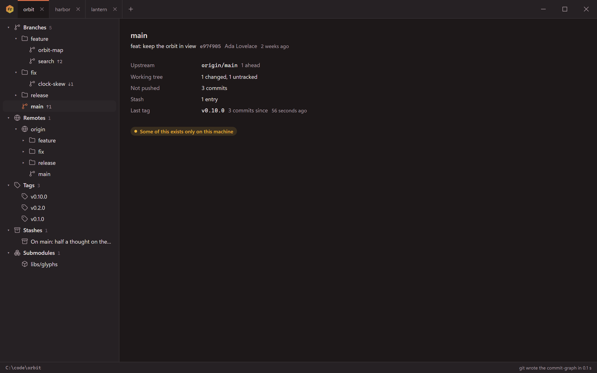

The desktop window is the third door onto the same engine as the CLI: what it
shows of a repository is what `furca refs` and `furca line` print, read the
same way, in-process. It is laid out as Fork lays a git client out - tabs of
repositories along the top, a column of refs on the left - and it draws its
own title bar, so the tabs sit in it rather than in a band under it.



## Get it

There is no installer yet: the window's installers wait for code signing, since
an unsigned one is what SmartScreen and Gatekeeper turn away. CI builds them for
every platform on every push, and the window builds from a checkout:

```sh
pnpm install
pnpm tauri build          # or `pnpm tauri dev` to run it from the source
```

See [CONTRIBUTING](https://github.com/lacodda/furca/blob/main/CONTRIBUTING.md)
for what it needs.

## Opening repositories

Each open repository is a tab. A repository opens

- from **Open repository…** (<kbd>Ctrl</kbd>+<kbd>O</kbd>), which asks for a
  folder;
- from **Recent**, the repositories opened lately, in the `+` menu after the
  tabs and on the empty window;
- by **dropping a folder** on the window - or a file: a path inside a working
  tree opens the repository around it, as `git -C` does;
- from a terminal: `furca-desktop PATH` opens `PATH`. With the window open
  already, the path opens as a tab in it and the window comes forward - there
  is one window, and its tabs are the one list of what is open.

Opening a repository that is open already brings its tab forward instead of
opening a second one, however the path was written. Two tabs with the same
directory name add their parent's, so the bar never shows two it cannot tell
apart.

| Keys | |
| --- | --- |
| <kbd>Ctrl</kbd>+<kbd>O</kbd> | Open a repository |
| <kbd>Ctrl</kbd>+<kbd>W</kbd>, <kbd>Delete</kbd> on a tab, a middle click | Close the tab |
| <kbd>Ctrl</kbd>+<kbd>Tab</kbd>, <kbd>Ctrl</kbd>+<kbd>Shift</kbd>+<kbd>Tab</kbd> | The next or the previous tab |
| <kbd>Ctrl</kbd>+<kbd>1</kbd> … <kbd>Ctrl</kbd>+<kbd>8</kbd>, <kbd>Ctrl</kbd>+<kbd>9</kbd> | That tab, the last tab |

Tabs are dragged along the bar to change their order; a strip too long for the
bar scrolls with the wheel. The keys are read by their place on the keyboard,
so they work on any layout.

## Sessions

A session is a set of tabs saved under a name: **Save tabs as a session…** in
the `+` menu. Opening it later replaces the open tabs with its own, in its
order, with the one that was in front in front again. Saving under a name
that is taken replaces that session, and the dialog says so first.

**The line** is a session that is never saved: every repository your
[rigger](https://lacodda.github.io/rigger/) record keeps - the list
[`furca line`](/furca/reference/line/) reads - fetched from the record each time
it opens, so a project added to the record is in it the next time. It is
offered only where rigger is installed.

A repository of a session that is no longer there is left out, and the window
says which.

## The left column

| Section | What it shows |
| --- | --- |
| **Branches** | Local branches, in folders by the `/` in their names. The branch `HEAD` is on is in bold with its mark in the accent; `↑2 ↓1` is how far it is from its upstream, and `gone` an upstream deleted on the remote and pruned. |
| **Remotes** | Each remote with its remote-tracking branches, in folders the same way. Pointing at a remote shows its address, without any password written into it. |
| **Tags** | Newest version first: `v0.10.0` comes before `v0.9.0`. |
| **Stashes** | The stash, newest first, by the message git wrote. |
| **Submodules** | Each submodule by its path, marked `not checked out` when it is not, and `moved` when what is checked out is not the commit the repository records. |

The distances are against the last fetch: the window reads this machine only
and asks no remote. The column is one control - <kbd>Tab</kbd> reaches it once,
the arrows move inside it, <kbd>Right</kbd> and <kbd>Left</kbd> open and close a
folder.

Beside the column is where the repository stands: the commit `HEAD` is on, the
upstream and the distance from it, what is changed, untracked, unpushed or
stashed, how far it has come since its last tag, and whether anything in it
exists only on this machine - the row `furca line` prints for it. The graph
takes this place in a later release.

The window reads a tab again when it comes forward and when the window gets
the focus back, so a commit made in a terminal meanwhile shows up.

## What the window writes

Nothing in your history. One file, in the background: when a repository has no
commit-graph file, or one more than a thousand commits behind, the window has
git write one - `git commit-graph write --reachable --split`, the file `git gc`
writes on its own - and the status line along the foot says so. Without it the
graph of a long history costs seconds to open; with it, milliseconds. A
repository with `core.commitGraph` set to `false` is left alone. See
[ADR 0010](https://github.com/lacodda/furca/blob/main/docs/adr/0010-the-window-has-git-write-the-commit-graph.md).

What the window remembers - the open tabs, the recent list, the sessions - is
one file, `state.json`, in the app's data directory: `%APPDATA%\com.lacodda.furca`
on Windows, `~/Library/Application Support/com.lacodda.furca` on macOS and
`~/.local/share/com.lacodda.furca` on Linux. A file that cannot be read is moved
aside as `state.broken.json` and the window starts empty.

`FURCA_DESKTOP_DATA` names another directory for all of it, the webview's own
profile included - for a run that must not touch the window you use every day.
Such a run is a window of its own: it neither hands its paths to the window you
use nor takes theirs.

## Speed

The window holds budgets of its own, measured on the built app before every
commit and with every release: it is on the screen within 300 ms of its start,
in the colours of your theme, and the app and its webview hold under 300 MB
with three repositories open. The first frame with a repository is measured
and published too. See [the budgets](/furca/concepts/budgets/).
